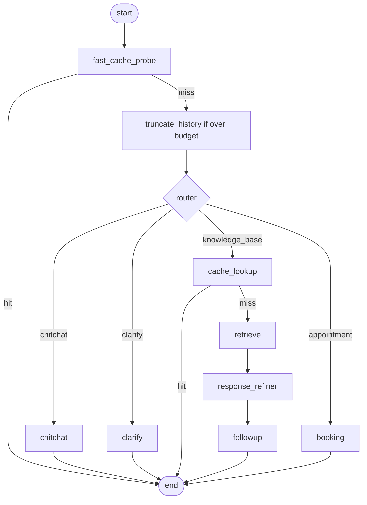
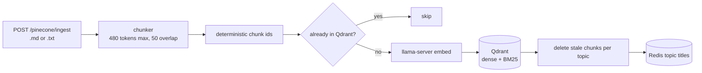

# MedAtlas

Medical chatbot monorepo: a Next.js chat client, an Express API, and a LangGraph agent.
It answers medical questions from a knowledge base (hybrid RAG with citations) and
books, cancels and reschedules appointments in natural conversation.

| Part | Stack |
| --- | --- |
| `client/` | Next.js 14 (app router), Tailwind v4, streaming chat UI with source panel and conversation history |
| `server/` | Express, TypeScript, LangGraph, Zod + OpenAPI |
| Storage | MongoDB (accounts, sessions, conversations, appointments, checkpoints, exact answer cache), Qdrant (dense + BM25 chunks), Redis (topic titles, semantic answer cache) |
| Models | OpenAI chat model (`OPENAI_MODEL`, default `gpt-6-luna`), local llama.cpp embedder (Qwen3-MedEmbed, 1024-d), Cohere `rerank-v3.5` |

## Quick start

Requires Bun 1.3+ and Docker.

```bash
cp .env.example .env          # also copy server/.env.example to server/.env and fill in keys
bun install
docker compose up -d redis qdrant mongo llama
bun run dev                   # client :3000, API :4000
```

Ingest the knowledge base once the infra is up (see [Ingestion](#ingestion)), then sign up at
`http://localhost:3000/auth`.

Run everything in Docker instead: `docker compose up -d --build` (adds `server` and `client`).
The server container mounts `server/.env`, and service URLs are overridden to compose hostnames.
`NEXT_PUBLIC_API_URL` is baked into the client image at build time (default `http://localhost:4000`).

### Environment

Set in `server/.env` (see `server/.env.example`; environment loading is relative to the working directory, and `tsx watch` does not reload it):

| Variable | Purpose |
| --- | --- |
| `OPENAI_API_KEY`, `OPENAI_MODEL`, `OPENAI_BASE_URL` | Chat model |
| `COHERE_API_KEY` | Reranker; without it hybrid retrieval falls back to fused order |
| `MONGODB_URI`, `MONGODB_DB_NAME` | Mongo (default `mongodb://127.0.0.1:27017`, db `medatlas`) |
| `REDIS_URL` | Redis (default `redis://127.0.0.1:6380`) |
| `QDRANT_URL`, `QDRANT_COLLECTION`, `EMBEDDING_DIMENSIONS` | Vector store (1024 dims) |
| `EMBEDDING_URL` | llama-server (default `http://127.0.0.1:8080`) |
| `HISTORY_TOKEN_BUDGET` | Token budget before history is truncated for model calls (default 3000) |
| `ANSWER_CACHE_TTL_SECONDS` | Answer cache lifetime (default 7 days) |
| `APPOINTMENT_TIMEZONE` | Default `Asia/Kathmandu` |

Environment files are local-only. Commit `.env.example`, never `.env`.

### Local ports

| Service | Address |
| --- | --- |
| Client | `http://localhost:3000` |
| API health | `http://localhost:4000/health` |
| Swagger UI / OpenAPI JSON | `http://localhost:4000/docs`, `/docs.json` |
| Redis | `localhost:6380` |
| Qdrant | `localhost:6333` |
| MongoDB | `localhost:27017` |
| llama-server (embeddings) | `localhost:8080` |

Compose sets CPU and memory limits per service. If you already run mongod or llama-server on the host, stop it or drop that service from the `up` command (port clashes).

### Embedding server

Compose runs the CPU image of llama.cpp. To run it by hand (GPU example):

```bash
llama-server -hf luluw/Qwen3-MedEmbed-0.6B-Miriad-32k-en-trim-gguf:Q4_K_M \
  -c 4096 --batch-size 768 --ubatch-size 768 -t 4 -ngl 999 \
  --host 0.0.0.0 --port 8080 --embedding --pooling last --parallel 8 --flash-attn on
```

`-c 4096` with `--parallel 8` gives 512 tokens per slot, which is the input limit the chunker and
embedding client respect. After changing the embedding model or pooling, drop the Qdrant collection
and re-ingest.

## Agent

One graph run per user message. History persists per `threadId` in the Mongo checkpointer, so
multi-turn flows such as booking need no tool loop.



- **fast_cache_probe**: answers repeat questions from the answer cache before any LLM call, and resets per-turn state.
- **truncate_history**: runs only when the transcript exceeds `HISTORY_TOKEN_BUDGET`. Model calls then see just the recent verbatim tail; the stored thread is untouched. A running summary of older user turns is built alongside each turn and read by the next turn's router.
- **router**: an exact click on the suggested follow-up, or a whole-message greeting/thanks/ack, skips the LLM (not while a clarification is pending). Otherwise structured output gives `route` (`chitchat`, `clarify`, `knowledge_base`, `appointment`), a standalone `query` that keeps negations verbatim, and `topicName`.
- **topicName**: set when the user names one disease or treatment. It is fuzzy-matched to topic titles in Redis (key `topics`) and becomes a Qdrant `topic` filter (up to 3 titles); an empty scoped search retries unscoped.
- **retrieve**: Qdrant dense + native `qdrant/bm25` sparse with RRF fusion, then Cohere rerank.
- **response_refiner**: writes the cited answer; turn off in `agent_config.ts` to return the top passages verbatim.
- **followup**: produces one suggested next question, rendered under the last answer.
- **booking**: one tool-calling model call (book, cancel, reschedule), then one call that words the result. The model asks only for missing details. Appointments live in Mongo.
- **Answer cache**: exact match in Mongo, plus a semantic tier in Redis (Redis 8 vector sets, cosine threshold in `agent_config.ts`). Negated queries skip the semantic tier because embeddings place "symptoms of X" and "not symptoms of X" almost together. Re-ingesting bumps a corpus generation that invalidates both tiers.

Feature switches (clarify, followup, refiner, semantic cache) live in `server/src/config/agent_config.ts`; restart the server after editing.

Users sign up and log in at `/auth`; `POST /agent/invoke` streams server-sent events (tokens, sources, `suggestions`, `done`) and needs the session cookie.

## Ingestion



Documents need top-level `#` topics and `##` sections with content. Uploads are limited to 20 MB
(`.md`, `.txt`).

```bash
curl -X POST http://localhost:4000/pinecone/ingest -F "file=@./assets/knowledge_base.txt"   # 202 + jobId
curl http://localhost:4000/pinecone/ingest/<jobId>                                          # progress
```

Or run the script: `bunx tsx server/scripts/ingest_kb.ts`.

- **Chunking** is in embedder tokens (480 max, 50 overlap), with a character-based estimate and an exact cap through llama-server `/tokenize`. Chunks keep metadata (heading path, block kind, token counts, table parts, overlap).
- **Idempotent**: chunk ids come from content, so re-ingesting skips stored chunks and removes stale ones. Any chunker change changes ids and forces full re-embedding (local compute only).
- **Quantization**: dense vectors use Qdrant TurboQuant 4-bit (pinned memory), which needs Qdrant 1.19+ (compose pins `v1.19.2`).
- Job state is in memory and lost on restart.

## Commands

```bash
bun run dev                    # client and API in watch mode
bun run typecheck              # TypeScript, client and server
bun run build                  # production builds (do not run while `next dev` is running)
bun run start                  # run compiled API
git diff --check               # no linter is configured
cd server && bunx tsx --test tests/*.test.ts          # all tests
cd server && bunx tsx --test tests/chunker.test.ts    # one file
```

Mongo-backed tests (`auth`, `appointment_operations`) use a throwaway `medatlas_test_*` database and
need Mongo running. Live scripts (ingest, retrieval checks and evals, agent smoke) are in
`server/scripts/`, for example `bunx tsx server/scripts/retrieval_eval.ts` (questions in
`server/tests/data/retrieval_eval.json`) and `bunx tsx server/scripts/chunk.ts ./knowledge.md`
for chunking diagnostics.

## Structure

```text
client/   Next.js app (chat shell, auth page)
server/   Express API, LangGraph agent (src/agent), services (src/service), scripts, tests
assets/   Knowledge base source (local, git-ignored)
```

See `AGENTS.md` for contributor and agent conventions.
